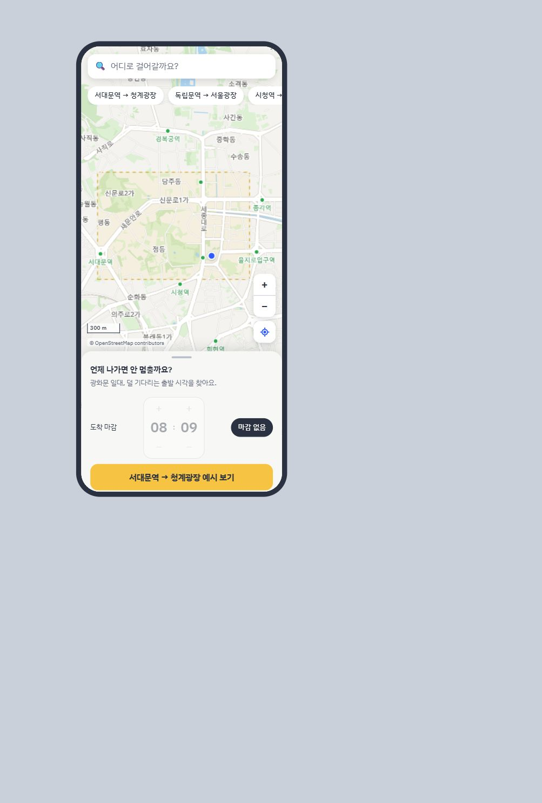
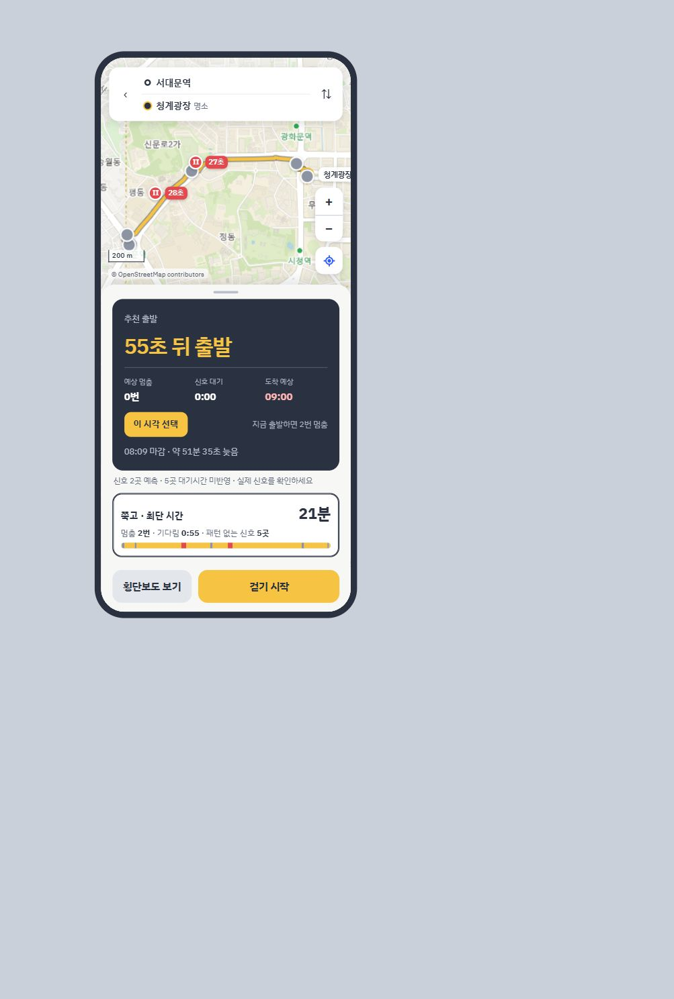
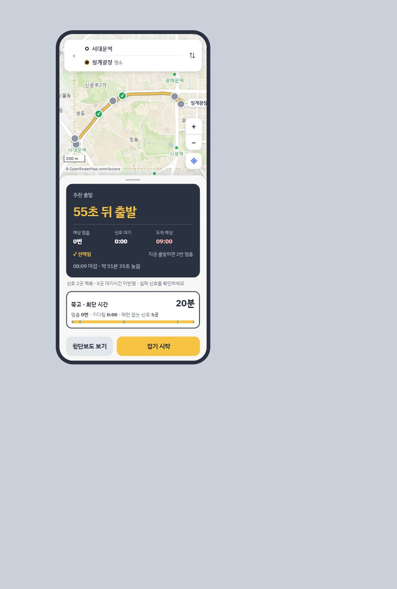
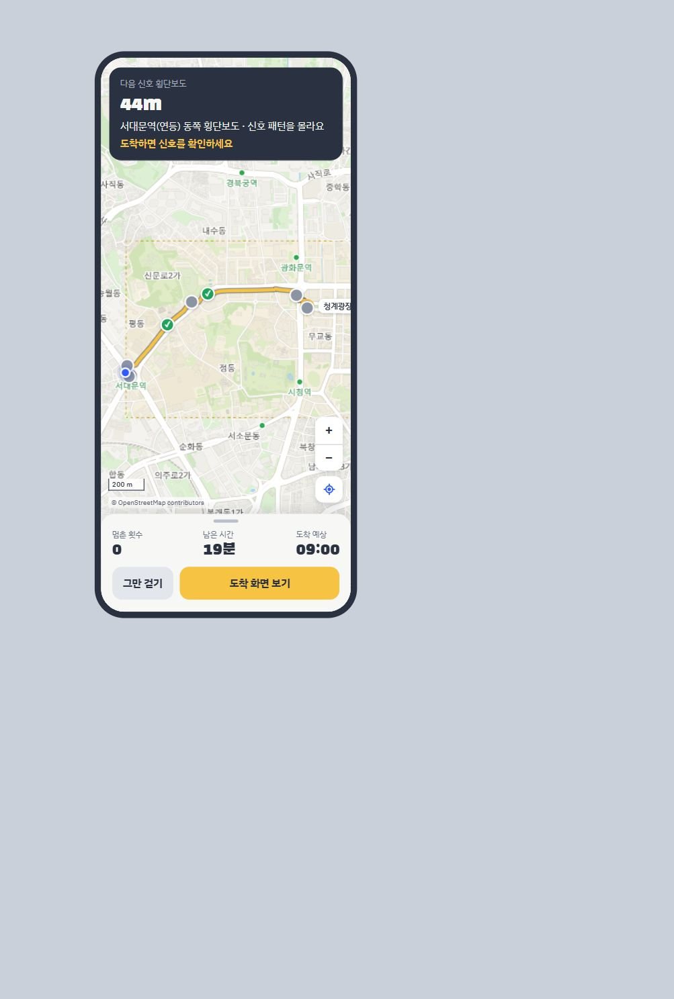

# 쭉고 제품 흐름 검토

검토일: 2026-10-28 (Asia/Seoul). Product Design `audit` 절차로 로컬 수정본을 직접 실행해 캡처·검토했다. BMAD 플러그인은 설치됐지만 이 검토에서 BMAD 다중 에이전트 토론을 실행한 것은 아니다.

## 검토 범위와 사용자 목표

범위: 홈에서 예시 경로를 열고 추천 출발을 선택한 뒤 걷기 화면에 진입하는 흐름. 목표: 사용자가 언제 출발하면 얼마나 덜 기다리는지 이해하고 다음 행동을 결정할 수 있는지 확인.

이번 검토는 새로 캡처한 아래 네 화면, 접근성 트리, 관련 소스에 근거한다. 전체 접근성 준수, 실시간 신호 정확도, 실제 GPS 안내를 검증한 것은 아니다. 저장돼 있던 마감 설정은 사용자 상태를 보존해 그대로 관찰했다.

## 1. 홈 — 진입 가능, 다음 행동의 강조 개선 필요

좋은 점: 목적지 검색이 상단에 있고 예시 경로로 핵심 기능을 바로 체험할 수 있다. 지도와 짧은 소개가 결합돼 있다.

문제: 하단에서 도착 마감 조절기가 상당한 공간을 차지하고 가장 강한 버튼은 예시 보기다. 처음 방문한 사용자는 자신의 경로 검색보다 예시 체험으로 유도될 수 있다. ‘언제 나가면 안 멈출까요?’라는 문구가 제공 가능한 예측 범위보다 넓은 약속으로 읽힐 수 있다.

제안: 자신의 출발·도착 선택을 기본 흐름으로 두고, 예시 체험은 별도의 짧은 진입점으로 둔다. 마감 설정은 선택 사항으로 접고, ‘덜 기다리는 출발 시각’처럼 제공 가능한 가치로 표현한다.

## 2. 추천 결과 — 추천과 현재 기준이 혼재

좋은 점: 추천 출발, 예상 멈춤, 신호 대기, 도착 예상이 한 카드에 정리돼 있다. 미관측 신호에 대한 각주가 있다.

문제: 추천 카드에는 0번, 경로 카드에는 2번, 지도에는 빨간 대기 표시가 나타난다. 각각 ‘추천 출발’과 ‘현재 선택 시각’이라는 다른 기준이지만, 읽는 부담이 사용자에게 전가된다. 저장된 08:09 마감과 09:00 도착이 충돌하는데도 중심 행동은 추천 시각 선택이다.

제안: 결과 화면 전체가 어떤 출발 시각 기준인지 상단에 고정 표시하고 지도·통계·버튼을 일치시킨다. ‘지금’과 ‘추천’ 비교를 제공한다면 각각의 라벨과 선택 상태를 분명히 한다. 마감 불가 시 결과 판단을 먼저 보여준다.

## 3. 추천 선택 — 상태 변경은 보이나 의미·시간 표현 개선 필요

좋은 점: ‘선택됨’으로 상태가 바뀌고 지도 신호와 경로 통계도 갱신된다.

문제: ‘0번’은 예측 가능한 2곳에 한정되고, 5곳의 대기는 도착 예상에도 들어 있지 않다. 작은 각주만으로는 ‘전체 길에서 한 번도 멈추지 않는다’는 해석을 막기 어렵다. 선택 후에도 ‘55초 뒤 출발’이 고정돼 기다림의 기준 시점과 유효성이 불명확하다.

제안: 핵심 통계에 ‘예측 2곳 중 멈춤 0번’, ‘나머지 5곳 미확인’을 연결한다. 시연에는 기준 시각과 시연 표시를 유지한다. 실제 서비스로 전환할 때만 현재 시각 기준 카운트다운, 추천 만료, 놓쳤을 때 재계산 흐름을 만든다.

## 4. 걷기 — 진입 가능, 시뮬레이션 명시 필요

좋은 점: 다음 횡단보도 거리와 신호를 모른다는 설명이 보인다. 실제 신호 확인 안내가 있다.

문제: 위치 마커가 자동 진행하고 ‘멈춘 횟수’와 ‘남은 시간’이 바뀌지만 시뮬레이션이라는 고정 표시는 없다. 소스상 약 9초 동안 경로를 재생하며 실제 GPS를 사용하지 않는다. ‘멈춘 횟수’는 실제 측정 기록으로 읽힐 수 있다.

제안: 버튼을 ‘걷기 시연’으로 표현하고 화면에 ‘경로 시뮬레이션’을 유지한다. 실제 안내 기능은 위치 획득, 진행 상태, 신호 데이터 최신성 검증 이후 분리해 제공한다.

## 우선순위와 완료 조건

| 우선순위 | 개선 | 완료 조건 |
|---|---|---|
| P0 | 시연·예측 범위 명확화 | 홈·결과·걷기에서 시연 여부가 보이고, 0번 옆에 관측 범위가 표시된다. 미관측 대기가 빠진 도착 예상임을 같은 맥락에서 이해할 수 있다. |
| P1 | 선택 시각 기준 통일 | 추천/현재 선택에 따라 지도·경로·핵심 통계가 같은 기준으로 갱신된다. 다른 기준을 비교할 때 각각 명확히 구분된다. |
| P1 | 출발 선택 후 흐름 | 시연에는 고정 기준 시각 표시. 실제 서비스에는 대기·출발·추천 만료 상태와 복구 행동이 정의된다. |
| P2 | 홈 진입 정리 | 자신의 출발·도착을 선택하는 동선이 발견되고 마감 없는 검색도 쉽게 진행된다. |
| P2 | 현장 검증 | 신호 방향·시간대별 패턴을 확인하고 예측/실측 대기 차이와 효과를 기록한다. 이는 UI 캡처 검토와 별개다. |

## 접근성 관찰과 검증 한계

- 긍정: 확대·축소·내 위치와 시간 조절 버튼에 이름이 있고 시·분 입력이 접근성 트리에 나타난다. 신호 모름은 글로도 설명한다.
- 위험: 지도 상태가 색·작은 기호에 크게 의존하고 회색 보조 문구는 작다. 시트 손잡이는 드래그 대안으로 키보드에서 높이를 바꿀 수 있는지 검증이 필요하다.
- 이번 캡처만으로 대비 수치, 확대 200% 재배치, 화면 읽기 도구의 실제 발화, 키보드 전체 동선의 준수를 확정할 수 없다.
- 출발 타이밍 효용 실험의 한계는 `experiments/DEPARTURE_EVAL.md` 참고. 새벽 패턴과 선별 경로의 시뮬레이션 결과를 실제 사용자 효과로 일반화하지 않는다.

## 제품 방향 — 제안

첫 검증 대상을 ‘매일 같은 광화문 경로를 걷고, 출발을 1분 정도 조절할 수 있는 사람’으로 좁히는 것을 제안한다. 핵심 질문은 ‘실제로 덜 기다리는가’와 ‘출발을 기다릴 가치가 있는가’다. 인터뷰나 현장 검증 전의 가설이며 사용자 확정 사항이 아니다.

지도 범위 확장, 공유 카드 고도화, 신규 기능 추가에 앞서 위 P0/P1을 검증하는 것을 권고한다. 이 문서에서는 후속 코드를 수정하지 않았다.
