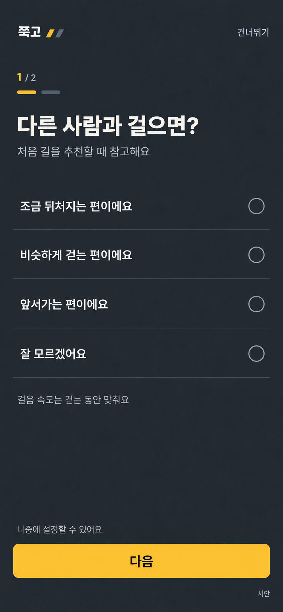
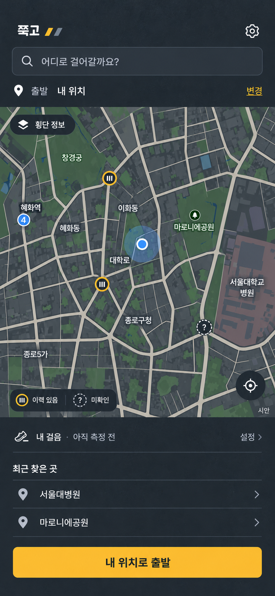
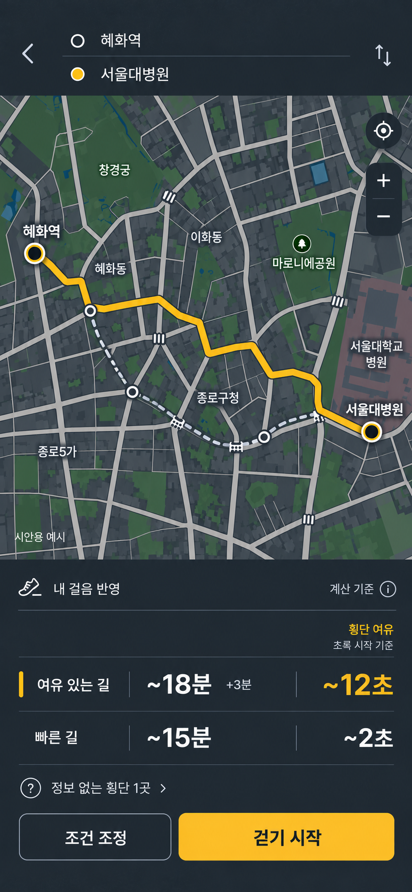
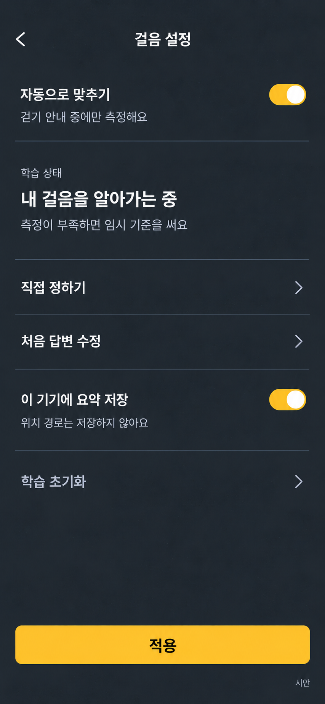

# 아스팔트 시각 방향·건너뛰는 설문·자동 걸음 맞춤

2026-10-29, Asia/Seoul. 사용자의 최신 수정 요청과 이미지 시안. 앱 코드·실제 측정기·설문·학습 시스템·배포를 구현한 것이 아니다.

## 사용자 확인 사항과 해석

- 이전 화면은 깔끔하지만 너무 흰색이고 아스팔트 느낌이 부족하다. 아스팔트/노랑 정체성을 강화한다.
- 사용자는 자기 보행속도를 숫자로 잘 모른다. 기본은 사용자가 걸을 때 속도를 측정·학습해 반영하는 방식이며 직접 속도를 선택하는 조절은 설정에서만 제공한다.
- 콜드 스타트에는 간단한 추천용 설문을 받고 건너뛰기를 허용하자는 사용자 제안. 정확한 문항·횟수·초기값·학습 알고리즘은 아직 미확정이다.
- ‘스크롤바’라는 표현은 문맥상 **속도 슬라이더**로 이해한다고 사용자에게 명시했다. 화면 스크롤바를 새로 표시하라는 지시로 해석하지 않았다.
- 사용자가 다시 첨부한 방향: 큰 핵심 값은 횡단 여유, 멈춤 횟수는 보조. 출발 전 계획과 지도 정보 층을 먼저, 실시간 소리/진동은 후순위. 걷기 기록·피트니스 화면으로 돌아가지 않는다.

작업 기준이 Claude 브랜치라는 최신 제품 정의도 읽었다(`origin/ccr-94bac9df-i81579`, 확인 시 `0c4f772`). 이번 시안/논의는 Codex 브랜치에 참고 산출물로 남기며 Claude 앱을 변경하지 않는다.

## 서비스 흐름 — 제안

**선택형 설문 또는 건너뛰기 → 목적지 검색/출발 전 지도 → 경로 비교 → 위치 허용 후 걷기 안내 중 측정 → 다음 추천에 점진 반영.**

1. 설문은 계정·연령·질환·장애를 필수로 묻는 절차가 아니다. 걷는 체감과 이번 이동 조건만 간단히 묻는다. 보호자/동행자라면 자신의 속도와 안내 대상의 속도를 혼동하지 않도록 대상 선택을 별도로 검토한다.
2. 예시 1단계는 ‘다른 사람과 걸으면?’에 뒤처짐/비슷함/앞서감/모름 네 선택지다. 상대 기준은 일정하지 않으므로 측정값이 아닌 낮은 신뢰의 자기보고다. ‘뒤처짐’ 표현이 불편할 수 있어 문구는 사용자 검토 대상이다.
3. 예시 2단계는 ‘이번 길에서 피하고 싶은 조건’으로 계단/급한 경사/동행 조건 등을 짧게 묻는 설계다. 지원하지 않는 시설 데이터를 확보한 것처럼 약속하지 않는다. 2단계는 이번 이미지에 별도로 그리지 않았다.
4. 모든 단계에서 건너뛸 수 있고 나중에 수정할 수 있다. 선택하지 않은 ‘다음’은 비활성으로 두되 건너뛰기는 항상 동작하게 한다. 특정 응답을 미리 선택하거나 필수 인적 정보를 받지 않는다.
5. 설문 응답을 특정 km/h 또는 진단으로 확정하지 않는다. 건너뛰면 공통 임시 기준으로 계산하고 ‘임시 기준’임을 표시한다. 임시값은 검증해야 할 제품 가정이며 이번에 새 숫자로 확정하지 않았다.
6. 위치 권한은 걷기 안내를 시작할 때 목적을 설명하고 요청한다. 자동 맞춤이 기본 선택이어도 OS/브라우저의 위치 허가를 대신하지 않는다. 거부하면 수동 출발지·기본 지도·명시적 임시 기준 비교가 남아야 한다.

## 자동 학습 상태와 횡단 여유 표시

| 상태 | 홈/설정 | 결과의 개인 횡단 여유 |
|---|---|---|
| 처음·설문 건너뜀 | 아직 측정 전 | 임시 기준임을 명시. 개인 여유 숫자를 확정하지 않음 |
| 관측 중·표본 부족 | 내 걸음을 알아가는 중 | 불안정한 개인 속도로 초 단위 숫자를 내지 않음. ‘여유 계산 준비 중’ 상태 필요 |
| 충분히 안정적인 관측 | 내 걸음 반영 | 신호 방향·진입/완료 구간·횡단거리도 확인된 곳에서만 근거와 함께 추정 표시 |
| GPS 낮은 품질·긴 공백 | 측정 잠시 멈춤 | 신뢰 가능한 이전 기준 또는 표시된 임시 기준. 오차 큰 값을 새로 학습하지 않음 |
| 직접 정하기 선택 | 직접 정한 속도 사용 | 사용자 설정 기준임을 표시. 자동 학습값이 조용히 덮어쓰지 않음 |
| 초기화 | 측정 전으로 복귀 | 과거 개인 속도를 삭제하고 다시 잠정 상태로 처리 |

‘자동 측정’은 앱이 사용자를 항상 추적한다는 뜻이 아니다. **사용자가 시작한 걷기 안내 동안만 관측**하는 것이 이번 설계다. 잠금/백그라운드 지속 GPS는 별도 실기기 검증 전에는 보장하지 않는다. 개인화가 된 이후에도 피로·짐·경사·동행 때문에 보행 속도는 달라질 수 있어 ‘학습 완료’라고 영구 확정하지 않는다.

### 측정 방식의 구현 후보 — 검증 전

- 유효한 위치 갱신과 시간으로 이동 구간을 평가한다. 기기가 제공한 speed가 있더라도 단일 값만 믿지 않는다. speed가 null일 수 있으며 좌표 차분도 GPS 오차에 취약하다.
- 정지·신호 대기·긴 위치 공백·GPS 튐·교통수단 이동으로 의심되는 관측은 기준 속도 학습에서 제외하거나 보류한다. 멈춤 원인을 모두 신호로 분류할 수 있다고 가정하지 않는다.
- 안정적인 보행 구간의 강건한 요약(예: 중앙값과 변동 범위)을 점진적으로 반영한다. 순간적으로 서두른 구간을 평소 속도로 즉시 끌어올리지 않는다. 반대로 지속적인 피로·이동 조건 변화를 영구히 이상치로 지워 버리지 않도록 세션과 평소 기준을 구분한다.
- 일반 보행로에서 추정한 속도가 횡단보도에서 그대로 유지된다는 가정도 검증한다. 학습이 정확해도 실제 횡단을 보장할 수 없다.
- 서버 AI나 대규모 학습 데이터가 필수인 구조는 아니다. 첫 구현은 기기 내 품질 검사·통계적 추정부터 검증할 수 있다. 관측 시간이 몇 분이면 충분한지, 최소 표본·오차 기준은 이번에 실증하지 않았다. 가짜 정확도 백분율·보행 횟수·완료율을 UI에 넣지 않는다.

**[공식 기술 근거]** [Geolocation speed](https://developer.mozilla.org/en-US/docs/Web/API/GeolocationCoordinates/speed)는 기기 속도(m/s)를 주지만 측정 불가 시 null일 수 있다. [accuracy](https://developer.mozilla.org/en-US/docs/Web/API/GeolocationCoordinates/accuracy)는 위치 정확도(m)이며 개인 보행속도의 정확도 보증이 아니다. 자동 보정은 구현 가능한 방향이지만 실제 보행자·저속·도심 GPS에서 검증해야 한다.

### 개인 데이터 제어 — 설계 제안

‘이 기기에 요약 저장’을 기본으로 두고, 원시 이동 경로의 영구 저장·계정 가입은 필수로 하지 않는 안이다. 토글을 끄면 세션 뒤 무엇을 남기지 않을지, 초기화 범위, 직접 설정 유지 여부를 구현 전에 명시한다. 이미지의 ‘위치 경로는 저장하지 않아요’는 **목표 설계**이며 새 기능의 실제 저장 구현을 검증했다는 주장이 아니다. 학습에는 위치의 일시적 처리가 필요할 수 있다.

## 시각 방향

- 면: 아스팔트 `#242A32`, 보조 면 `#303844`, 구분선 `#46505D`.
- 글: 따뜻한 흰색 `#F4F2E9`, 보조 `#B7BEC8`.
- 강조: 도로 페인트 노랑 `#F6C343`, 작고 반복 가능한 사선 표식.
- 거친 도로 사진을 깔지 않고 빈 면의 약한 광물 질감으로 표현한다. 글자 뒤는 평평하게 유지한다. 가독성을 해치는 노이즈·네온·번쩍이는 카드·큰 로고는 피한다.
- 이전 피드백의 큰 패널/카드/라디오/홍보문구를 결과 화면에 부활시키지 않는다. 지도·짧은 경로 두 행·핵심 행동 구조를 유지한다.
- 생성 이미지에는 약한 명암 변화가 남아 있다. 구현 단계에서는 질감을 줄이거나 없앨 수 있고, 낮 야외/저시력/작은 화면의 대비·터치·글자 크기를 별도로 검증해야 한다. ‘어두운 화면’만으로 아스팔트 정체성과 접근성이 완성됐다고 판단하지 않는다.

## 새 시안 네 장

모두 이미지 생성 도구로 만든 가상 상태다. 실제 지도 경로·위치·신호·학습 결과가 아니다. 이전 흰색 시안은 보존하고 별도 폴더에 추가했다.

### 건너뛰는 첫 설문

속도 숫자를 입력시키지 않는다. 1/2는 제안된 두 단계 중 첫 화면이며 2단계 상세와 미선택 버튼 동작은 별도 설계가 필요하다.

### 처음 들어온 홈·횡단 정보 층

‘아직 측정 전’ 표시. 노란 횡단 표식은 **이력이 있다는 뜻**으로 설계했으며 지금 초록·안전·충분한 여유를 뜻하지 않는다. 미확인 표식도 남긴다. 개인 속도를 모르는 초기 홈에서 개인 여유 초를 꾸며내지 않는다.

### 관측이 쌓인 뒤의 결과 — 미래 예시

‘내 걸음 반영’과 큰 횡단 여유가 같은 화면에 있다. **이 이미지는 학습 관측과 해당 신호의 물리적 검증이 충분하다는 조건의 미래 예시**다. 현재 데이터가 그 조건을 달성했다는 뜻이 아니다. 12초/2초·18분/15분은 가상이며 실제 출발 시점의 건널 허가가 아니다. 숫자 근처에 초록 시작 기준을 둔다. 학습 전/부족 상태는 위 상태 표처럼 별도 렌더링해야 한다.

### 자동 맞춤 설정

자동 맞춤을 기본 선택으로 두고 상태·설문 수정·직접 정하기·저장/초기화를 제공한다. 속도 슬라이더는 ‘직접 정하기’ 하위에서만 노출하며 이 기본 설정 화면에는 나타내지 않는다. 기존 피트니스/기록 앱의 독립 프로필 화면이 아니다.

## 사용자가 다시 보낸 컨셉 자료의 판정

- ‘내 속도로 걸어도 되는 길’과 출발 전 계획을 시안의 기준으로 삼았다. 큰 횡단 여유는 멈춤 횟수보다 우선하며, 이후 쉼/이동 시설을 확장하더라도 개인 이동 조건이 중심이다.
- ‘그늘로와 겹치지 않음’은 여전히 확정 근거가 없다. 앞선 조사에서 그늘로도 경사·계단·개인 취향을 설명했다. 세부 비교와 실제 선택의 추가가치로 검증한다.
- ‘서울 실시간 신호 API 11/15 종료’는 기존 API 전환 안내이며 전체 신호 제공 종료가 아니다. [공식 공지](https://t-data.seoul.go.kr/board/notice/detail.do?boardId=104).
- 자동 걸음 맞춤이 가능하더라도 신호 방향·국내 점멸 코드·실제 횡단 길이·날짜 안정성의 문제는 따로 해결해야 한다. [답변 Q1~Q4와 시험](answers/CODEX_ANSWERS_2026-10-29.md). 설문이 이 공백을 메우거나 무장애 통행을 보장하지 않는다.
- 매일 쓰는 앱인지, 필요할 때 쓰는 도구인지도 미검증이다. 5명 인터뷰는 시작점이며 규모·사업성 입증이 아니다. 첫 장소 방문 전에 경로 선택이 바뀌는지부터 검증한다.

## 생성·검토·저장

- 사용자 요청으로 실제 UIUX 에이전트 `/root/uiux_revision`이 설문/학습 상태/색 토큰을 제안하고 최종 네 장을 직접 열어 검토했다. 아스팔트 정체성·수동 숫자 제거·기본 자동 맞춤·건너뛰기 반영을 확인했고 큰 오탈자는 발견하지 못했다. 기능 동작 검증은 아니다.
- 도구는 내장 Image Gen. 첫 두 참조는 이전 조건/결과 시안, 이후에는 새 설문/홈을 실제 이미지 경로로 첨부했다. 390×844 논리 비율의 독립 모바일 화면을 각 호출로 생성했다.
- 공통 프롬프트: matte asphalt, warm chalk text, golden road paint, very subtle mineral texture, practical 14–16px UI, no hero/large cards/neon/device chrome; no numeric speed before measurement; no live crossing instruction; current date 2026-10-29.
- 화면별 프롬프트: 선택형 설문(숫자/진단 없이 상대 보행 체감·건너뛰기), 홈(측정 전·이력/미확인 층), 결과(측정이 쌓인 이후·작은 두 경로 행·정적 여유), 설정(자동 기본·학습 중·수동 하위 메뉴).
- PNG는 생성 원본 그대로 복사해 이 보고서 상대 경로에 보관했다. 앱 코드·실제 설문 수집·GPS 학습·배포·workflow 설정은 수정하지 않았다.
- 아직 이미지로 없는 필수 상태: 설문 2단계/미선택, 위치 권한 거부, 학습 부족 결과, 측정 중지/다시 연결, 직접 조절 하위 화면, 초기화 확인. 이번 네 장을 전체 앱 완성이라고 표현하지 않는다.
