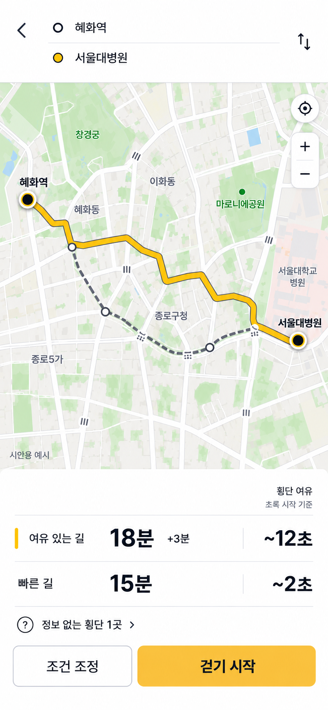
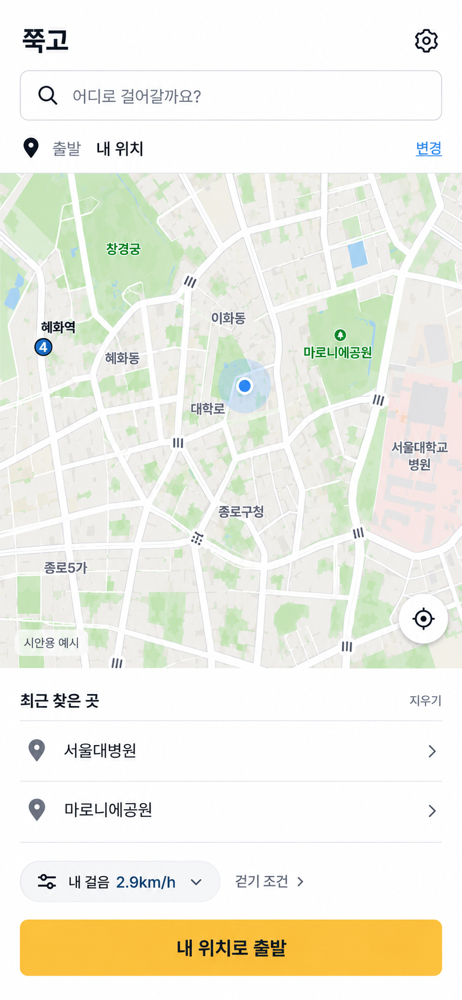
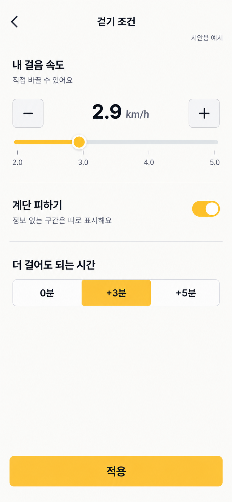
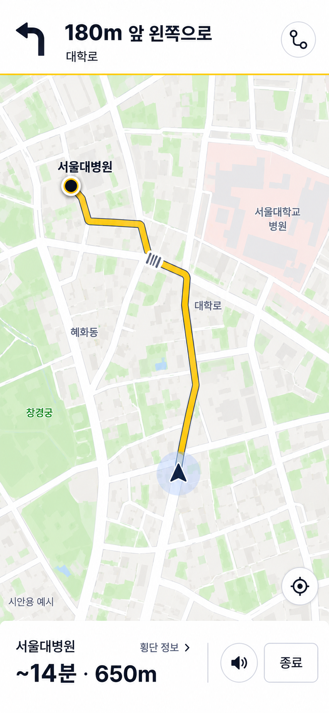

# 쭉고 서비스 흐름·UI 이미지 시안과 구현 가능성

2026-10-29, Asia/Seoul. 사용자가 서비스 설계·UI를 사진으로 먼저 보고 싶다고 요청했고, 두 번의 빨간 표시 피드백을 반영했다. 이번 산출물은 **이미지 시안**이다. 실제 경로·신호·GPS를 연결한 앱이나 배포가 아니다. 앱 코드는 수정하지 않았다.

## 사용자 피드백과 최종 수정

1. 처음 생성한 이미지는 앱보다 소개 포스터처럼 보였다. 사용자는 지도 위 대형 쭉고 로고/경로 제목과 하단 긴 설명을 빨간색으로 표시했다. 결과 화면에서 대형 로고·홍보 제목·문장·밑줄 장식을 삭제하고 출발/도착 툴바로 바꿨다. 긴 설명은 향후 ‘계산 기준’ 상세로 옮기는 설계다.
2. 두 번째 이미지는 하단의 큰 시트·선택 테두리 카드·라디오·조건 칩이 인위적이고 과했다. 사용자가 전체 하단을 다시 표시하며 수정과 다른 필수 화면 2~3개를 요청했다. **지도를 크게 유지하고 경로 두 행과 행동 바만 남기는 방식**으로 고쳤다. 속도·계단·허용 추가시간은 별도 조건 편집에서 다룬다.
3. 사용자가 UIUX 에이전트 사용을 명시해 실제 별도 에이전트 `/root/uiux_revision`이 원본 이미지 검토, 픽셀 위계, 두 차례 수정안을 제안했다. 이미지 생성과 통합은 부모가 수행했다. 역할 이름만 붙인 독립 검토라고 쓰지 않는다.

이전의 세 번째 ‘지도 층’ 후보는 생성 도중 사용자 수정 요청으로 중단했다. 최종 산출물은 경로 변형 네 개가 아니라 **수정한 결과 화면 + 다른 역할의 홈·조건·걷는 중 세 화면**이다. 생성 이미지 안의 지도와 숫자는 모두 예시이며 지명/입구/도로/진입 방향의 실제 정확성을 보증하지 않는다.

## 서비스의 첫 흐름 — 설계 제안

**목적지 선택 → 내 걸음·이동 조건 조정 → 같은 목적지의 길 비교 → 선택한 길로 걷기.**

- 당사자나 동행자가 외출 전에 낯선 병원·시장·역 주변의 보행 부담을 비교하는 장면을 우선한다.
- 외부 약속은 ‘서두르지 않아도 되는 길’, 내부 기준은 개인 보행속도·이동 조건·허용 추가시간에 맞는 선택이다. 실제 효용·재사용·사업성이 검증됐다는 뜻은 아니다.
- ‘나이키 런의 걷기 버전’ 비유는 걷기에 집중한다는 취지로 이해한다. 최신 Claude 제품 정의에서 삭제하기로 한 그냥 걷기·기록·피트니스 메뉴를 이번 시안에서 되살리지 않는다.
- 휠체어 무장애 보증, 버스·지하철, 실시간 횡단 허가, 보폭/속도 증가 지시는 이번 범위에서 제외한다.

## 최종 이미지

화면은 390×844 논리 크기의 모바일 비율을 목표로 Image Gen에서 생성했다. 코드로 측정한 픽셀 일치·반응형·키보드·터치 검증을 한 것은 아니다. 단일 화면 이미지를 그대로 저장했으며, 이미지 생성 후 임의로 잘라 붙이거나 그리지 않았다.

### 경로 선택 — 과한 하단 패널 축소

- 간결한 출발/도착 툴바, 넓은 지도, 경로 두 행.
- 선택은 작은 노란 선으로 표시한다. 카드 전체 테두리·큰 라디오·홍보 설명을 없앴다.
- 횡단 여유 열 가까이에 ‘초록 시작 기준’을 둔다. 미확인 횡단을 별도로 표시한다.
- 조건 조정과 걷기 시작만 하단 행동으로 남긴다.

### 출발 전 홈

- 목적지 검색, 출발 위치, 내 위치 지도, 최근 목적지 두 행.
- 걸음/걷기 조건 편집 진입과 ‘내 위치로 출발’ 주 행동.
- 실제 구현 때 목적지 미선택 상태의 주 버튼은 목적지 선택 단계로 이어져야 한다. 빈 목적지로 경로 걷기를 시작하지 않는다. 시안의 위치 점은 실제 권한 획득이나 GPS 성공의 증거가 아니다.

### 걷기 조건 편집

- 속도 직접 조절, 계단 피하기, 더 걸어도 되는 시간, 적용.
- 기록 앱의 독립 ‘내 걸음’ 기능이 아니라 홈/결과에서 열고 돌아오는 보조 편집 화면이다.
- 2.9km/h(약 0.8m/s), 속도 범위 2~5km/h, +3분은 예시이지 기본값·허용 범위 확정이 아니다. 실제 대상의 더 낮은 속도와 선호 범위를 배제하지 않도록 검증한다.
- 계단 피하기를 켜도 정보가 없는 구간은 미확인으로 남는다. 휠체어 통행 보증을 뜻하지 않는다.

### 걷는 중

- 다음 회전과 거리, 큰 지도, 남은 예상 시간·거리, 음성/종료.
- 큰 선택 패널·운동 통계·신호 카운트다운을 넣지 않았다.
- ‘지금 건너세요’·‘서두르지 않아도 다음 초록’ 같은 실시간 확정 안내는 제외했다. 횡단 정보는 선택적 보조 상세로 진입한다.
- 180m·650m·약 14분은 예시다. 현재 위치/회전/ETA가 실제 계산됐다는 뜻이 아니다. 음성 버튼은 설계 요소이며 잠금/백그라운드 음성의 동작 검증은 별도다.

## 구현 가능성과 자료의 충분성

**판정: 화면과 기본 길찾기 흐름은 구현 가능하다. 횡단 여유를 신뢰할 수 있게 제공하는 서비스는 좁은 구역에서 자료를 맞춰 검증해야 하며, 서울 전역 실시간 횡단 안내를 만들 데이터가 충분하다고 판단하지 않는다.**

| 기능 | 현재 근거 | 부족한 것·첫 범위 |
|---|---|---|
| 검색·출발/목적지·경로 비교 UI | 기존 프로토타입과 보행망 자산 | 임의 장소의 실제 출입구 연결/계단·경사/지도 최신성 검증. UI 이미지가 엔진 품질을 증명하지 않음 |
| 개인 속도 입력·적용 | 계산 입력으로 구현 가능 | 전체 검색/시뮬레이터/ETA에 일관되게 반영. 대상에 맞는 속도 범위·오차·선호 확인 |
| 화면을 켠 상태의 위치 갱신 | 웹 Geolocation 가능, HTTPS·사용자 허가·Permissions-Policy 조건 | PC/내장 브라우저·권한 거부·정확도·실제 휴대전화 검증. GPS 값만으로 정밀한 보도 위치를 보장하지 않음 |
| 횡단보도 거리 | OA-21209 sample 실제 수령, `LNKG_LEN` 존재. OA-15554 정의서 `HOL`, `VEL` 존재 | sample 총 31,080은 NODE/LINK 행 수이며 횡단보도 수 아님. 전량·공식 단위·횡단 축·방향·중앙섬·현장 대응 확인 |
| 과거 신호 기반 정적 여유 | 공식 14일 가공 자료 확보 | PDSG 방향과 국내 점멸 상태 의미 미확정. 날짜별 안정성도 미달. 핵심 입력 미확인이면 큰 초 숫자를 생략해야 함 |
| 지금/도착 시각의 건널 여유·음성 페이스 | 새 통합 실시간 API 안내 존재 | 새 키 권한·지연·실제 응답·개인 도착오차·진입 가능 고정녹색과 완료용 점멸 분리. 출시 가능한 수준으로 검증되지 않음 |
| 휠체어 무장애 경로 | 일부 계단·시설 데이터 후보 | 턱/폭/노면/시설 운영/연속 통행 검증 부족. 첫 데모 약속으로 삼지 않음 |

근거:

- [앞선 답변 Q1~Q7의 실제 확인·14일 시험](answers/CODEX_ANSWERS_2026-10-29.md): 평일 LODO 평균 95.36%지만 일치율 ≥95% 셀 비율은 82.60%로 제안 합격 기준 90%에 미달. 물리적 횡단 성공률이 아니다. 이 수치를 서비스 전체 정확도로 광고하지 않는다.
- [서울 횡단보도 OA-21209](https://data.seoul.go.kr/dataList/OA-21209/S/1/datasetView.do), [OA-15554](https://data.seoul.go.kr/dataList/OA-15554/S/1/datasetView.do): 세부 샘플/정의서 실제 수령은 앞선 답변에 방법·한계가 있다. 이번 시안 작업에서 다시 전량 수집한 것은 아니다.
- [T-Data 전환 공지](https://t-data.seoul.go.kr/board/notice/detail.do?boardId=104): 11/15는 기존 API의 종료이며 대체 실시간 API와 일별 파일 안내가 있다. 전체 신호 데이터 종료로 표현하지 않는다.
- [MDN watchPosition](https://developer.mozilla.org/en-US/docs/Web/API/Geolocation/watchPosition): 웹 위치 갱신의 HTTPS·허가 조건 확인. 웹 API 존재를 화면 잠금/백그라운드 지속 동작 보장으로 확대하지 않는다.

### 권장 첫 검증 — 제안

방향·실제 거리·점등/점멸을 대조한 몇 개 횡단보도가 있는 구역을 정한다. 사용자 입력 속도로 정적 횡단 부담과 경로의 추가시간을 함께 비교한다. 모르는 구간은 별도 표시하고 자료가 핵심적으로 부족하면 여유 숫자를 내지 않는다. 실제 선택 변화·추가시간 수용·숫자 의미의 오해부터 검증한 뒤 위치 기반 안내를 확장한다. 수집기 재활성화·실시간 연동·앱 구현·배포를 이번에 수행한 것은 아니다.

## 생성·검토 기록

- 도구: 기본 내장 Image Gen. Product Design의 get-context/ideate와 imagegen 스킬을 적용했다. 사용자의 수정 요청과 추가 화면 요청에 따라 초기 대안 선택 흐름 대신 한 디자인을 수정하고 필요한 세 화면을 생성했다.
- 실제 참조: 처음에는 저장소의 `docs/assets/results-simplified-2026-10-29/simplified-single-route.png`, 수정 때 사용자의 빨간 표시 이미지, 나머지 화면에는 최종 경로 결과 이미지를 도구에 첨부했다.
- 최종 독립 이미지 검토: UIUX 에이전트가 네 장을 직접 열어 큰 카드/라디오 제거와 화면 역할 분리를 확인했다. 심각한 한글 오탈자는 발견하지 못했으나 기능 동작 검증은 아니다. 조건 편집은 제안했던 작은 시트 대신 전체 화면으로 생성됐으므로 원래 경로 보존과 적용/취소 복귀가 필요하다. 최저 2.0km/h보다 느린 사용자 지원과 실패 상태 검증도 남겼다.
- 프롬프트 공통 기준: literal mobile navigation screenshot; 390×844 logical pixels; flat yellow/asphalt/warm-white; body 14–16px; title max 22px; 48px button; 16px margins; no poster/hero/large wordmark/gradient/nested cards; no device chrome; no real-time crossing permission; mock example labels.
- 결과 프롬프트: 하단은 짧은 두 경로 행+미확인 링크+작은 조건 버튼/걷기 버튼, 선택 테두리/라디오/옵션 칩 제거, 지도 확대.
- 홈 프롬프트: 검색/내 위치/최근 목적지 두 행/조건 진입, 경로 미선택 상태, 홍보·통계 없음.
- 조건 프롬프트: 숫자 직접 편집과 슬라이더, 계단 토글, 허용 추가시간, 적용만. 피트니스·기록 기능 없음.
- 걷기 프롬프트: 회전 지시, 넓은 지도, 남은 시간/거리, 음성/종료, 확정적 신호 안내 없음.
- 생성 PNG 원본을 복사해 위 상대 경로로 보관했다. OS/브라우저 계정 화면 캡처가 아니며 비밀값·실제 위치 이력은 포함하지 않는다.
- 아직 부족한 상태: GPS 거부/낮은 정확도, 목적지 검색 결과, 자료 부족, 경로 없음, 종료 확인, 계산 기준 상세는 이번 네 장에 포함하지 않았다. 실제 UI 구현 시 필요한 상태다. 렌더링된 글자/간격은 구현 시 다시 검증해야 한다.

이번 앱 변경/배포는 없다. 문서와 최종 시안 이미지 네 개만 GitHub에 기록한다.
